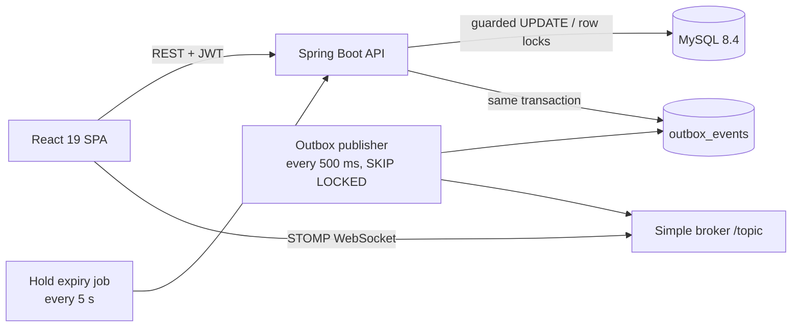
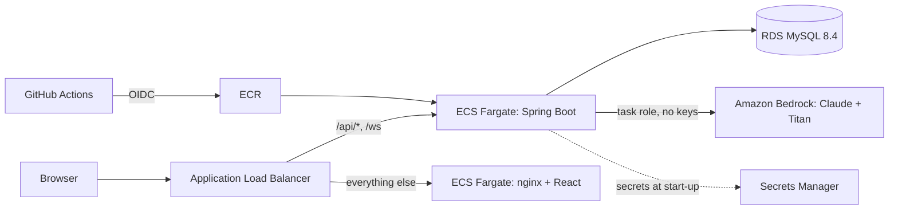
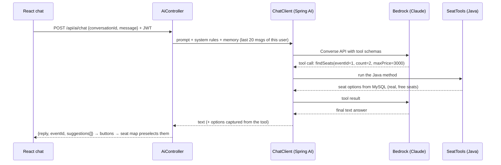

# SeatSure — high-concurrency event ticket booking

When tickets for a popular show go on sale, thousands of people click the same seats in the same second. SeatSure is a full-stack booking platform built to stay **correct under that load**: no seat is ever sold twice, abandoned carts free their seats automatically, a retried payment never charges twice, and every open browser sees seats disappear in real time.

**Stack:** Java 17 · Spring Boot 4.1 · Spring Security 7 (JWT) · Spring Data JPA / Hibernate · Flyway · MySQL 8.4 LTS · WebSocket (STOMP) · **Spring AI 2.0 + Amazon Bedrock (Claude, Titan embeddings)** · Micrometer + Prometheus · React 19 + TypeScript + Vite · Testcontainers · Docker · **Terraform (AWS: VPC, ECS Fargate, RDS, ALB, Secrets Manager, IAM)** · **GitHub Actions CI/CD with OIDC** · k6

---

## What it does

1. Browse upcoming events and see live availability.
2. Pick up to 6 seats on an interactive seat map (Premium / Standard / Economy tiers).
3. **Hold** them for 5 minutes with a visible countdown. Nobody else can take them.
4. **Pay and confirm.** Double clicks and network retries are safe.
5. Seats taken by others turn grey on your screen instantly, without refreshing.
6. Admins create events; the seat grid and pricing are generated automatically.
7. **AI assistant** (Claude on Bedrock): "2 seats together for Indie Night under ₹3000" → suggests real, currently free seats as buttons; answers policy questions from the help centre (RAG).
8. **AI copywriter** for admins: drafts an event description as structured JSON.

## Architecture



### Production on AWS



### The AI request flow



```
backend/src/main/java/com/seatsure
├── ai/        Spring AI: ChatClient config, tools, RAG ingestion, concierge, copywriter
├── config/    Security (JWT resource server), WebSocket, rate limiting, typed properties
├── user/      Register / login, token issuing
├── event/     Events, seat grid, guarded seat UPDATE queries
├── booking/   Hold → confirm flow, idempotency, payment boundary, expiry job
├── outbox/    Transactional outbox writer + publisher
└── common/    RFC 9457 error handling, seed data
```

## The engineering decisions (the interesting part)

### 1. No double booking — the WHERE clause is the lock
Holding seats is one guarded statement:

```sql
UPDATE seats SET status='HELD', hold_id=?, version=version+1
 WHERE event_id=? AND id IN (?) AND status='AVAILABLE'
```

InnoDB row-locks each matching row, and only rows still `AVAILABLE` match. If the affected-row count is less than the number of seats requested, the service throws and the **whole transaction rolls back** — the user gets all seats or none. No `synchronized`, no Redis lock, no `SELECT … FOR UPDATE` round trip. It works the same across any number of app instances.

**Proof:** `BookingConcurrencyTest` fires 50 threads at one seat on a real MySQL (Testcontainers) and asserts exactly 1 wins and 49 get a conflict. Other tests cover overlapping multi-seat holds, 10 parallel confirms with one idempotency key, and hold expiry.

### 2. Seat holds that expire
A hold is a row with `expires_at`. `HoldExpiryJob` sweeps due holds every 5 seconds, releasing each **in its own short transaction** (one failure never blocks the rest). It locks the hold row and re-checks the status, so running it on several instances at once is safe.

### 3. Idempotent payment confirmation
`POST /api/holds/{id}/confirm` requires an `Idempotency-Key` header (the UI generates one per hold).
- Same key again → the same booking is returned, no second charge.
- The hold row is locked `FOR UPDATE`, so parallel confirms queue up instead of racing.
- `bookings.hold_id` is `UNIQUE` — the database is the final guard.
- **Isolation matters:** confirm runs at `READ_COMMITTED`. Under MySQL's default `REPEATABLE_READ`, a request that waited for the lock would still read its old snapshot and miss the booking the first request just committed.

### 4. Transactional outbox → live seat map
Every seat change writes an `outbox_events` row **in the same transaction**. A publisher drains it with `SELECT … FOR UPDATE SKIP LOCKED` (several instances can share the work) and pushes to `/topic/events/{id}/seats`. Clients never see a change that rolled back, and never miss one that committed. Delivery is at-least-once; each seat carries a `version`, and the UI ignores stale or duplicate messages.

### 5. AI that can't break the core
- **The model suggests, Java decides, the human acts.** Tools are read-only. Seat options come from `SeatFinder` (plain, unit-tested Java) reading MySQL, so the model can't invent a seat. Holding and paying always need the user's click.
- **Tool calling:** `listUpcomingEvents`, `findSeats`, `searchHelpCentre` are `@Tool` methods; Spring AI sends their JSON schemas to Claude via the Bedrock Converse API and runs the loop.
- **RAG as a tool ("agentic RAG"):** help-centre markdown is split per section, embedded with Titan Text v2 at start-up and stored in a `SimpleVectorStore`. The model searches it only when a policy question needs it.
- **Memory:** `MessageWindowChatMemory` (last 20 messages), keyed by user id + conversation id so users can't read each other's history.
- **Structured output:** the copywriter returns `EventCopy(description, highlights)` via `.entity(...)`, then server-side limits are enforced anyway.
- **Guardrails and cost:** system-prompt scope rules, 500-char input cap, per-user AI rate limit (8/min), signed-in users only, 503 with a friendly message when Bedrock fails, latency timer `seatsure.ai.concierge.latency`.
- **Off by default:** AI turns on only with the `aws` profile, so the app, tests and CI run without AWS.

### 6. Other production concerns
| Concern | How |
|---|---|
| Schema changes | Flyway migrations; Hibernate never touches DDL |
| Auth | Stateless JWT (HS256) via Spring's OAuth2 resource server; roles in a claim; `ADMIN` routes protected |
| Abuse | Per-user token-bucket rate limit on seat holds (10/min) |
| Errors | One RFC 9457 `ProblemDetail` shape; 409 for conflicts, 410 for expired holds, 429 for rate limits |
| N+1 queries | Event list uses one `GROUP BY` for all events' seat stats |
| Deadlocks | `READ_COMMITTED` avoids gap locks; any lock failure maps to a retryable 409 |
| Observability | Actuator health probes; Micrometer counters `seatsure.holds{result}` and `seatsure.bookings{result}` at `/actuator/prometheus` |
| Container | Multi-stage Docker images, non-root user |

## Run it

**Everything in Docker**
```bash
docker compose up --build
```
- App: http://localhost:3000
- API docs: http://localhost:8080/swagger-ui.html
- Demo admin: `admin@seatsure.dev` / `Admin@123` (two demo events are seeded)

**Local development**
```bash
docker compose up mysql              # database only
cd backend && mvn spring-boot:run    # API on :8080
cd frontend && npm install && npm run dev   # UI on :5173 (proxies /api and /ws)
```
Open two browsers side by side, hold seats in one, and watch them turn orange in the other.

**Tests** (Docker must be running — Testcontainers starts MySQL 8.4)
```bash
cd backend && mvn test
```

**Load test** (needs [k6](https://k6.io))
```bash
k6 run load-test/flash-sale.js      # 200 users rush 10 seats: expect 10 wins, 190 × 409, zero 5xx
```

## Deploy to AWS (step by step)

Prerequisites: an AWS account, AWS CLI v2 configured (`aws configure`), Terraform ≥ 1.10, Docker, a GitHub repo for this code.

1. **Enable Bedrock models** (console → Amazon Bedrock → Model access, Region ap-south-1): Anthropic Claude Haiku 4.5 and Amazon Titan Text Embeddings V2. Anthropic models ask for a short use-case form the first time.
2. **State bucket (once):**
   ```bash
   cd infra/bootstrap && terraform init && terraform apply -var="state_bucket_name=seatsure-tfstate-<account-id>"
   ```
3. **Create the registries first** (images must exist before ECS can start):
   ```bash
   cd infra && cp terraform.tfvars.example terraform.tfvars   # set github_repo
   terraform init -backend-config="bucket=seatsure-tfstate-<account-id>"
   terraform apply -target='aws_ecr_repository.app'
   ```
4. **Push the first images (tag v1) by hand:**
   ```bash
   REG=<account-id>.dkr.ecr.ap-south-1.amazonaws.com
   aws ecr get-login-password --region ap-south-1 | docker login --username AWS --password-stdin $REG
   docker build -t $REG/seatsure-backend:v1 backend  && docker push $REG/seatsure-backend:v1
   docker build -t $REG/seatsure-frontend:v1 frontend && docker push $REG/seatsure-frontend:v1
   ```
5. **Create everything else:** `terraform apply` (≈10–15 min, mostly RDS). Open the `app_url` output.
6. **Wire up CI/CD:** in GitHub → Settings → Secrets and variables → Actions → *Variables*, add `AWS_DEPLOY_ROLE_ARN` (the `github_deploy_role_arn` output) and `AWS_REGION` = `ap-south-1`. From now on every push to `main` runs CI, then **Deploy to AWS** builds images tagged with the commit SHA and rolls them out.
7. **Tear down** when you're done practising: `terraform destroy` (the NAT gateway, ALB and RDS cost money every hour).

Budget tip: `enable_nat_gateway = false` (the default in the example tfvars) runs tasks in public subnets with security groups that only admit the ALB, saving the NAT gateway cost. Set it to `true` for the production layout.

**Use Bedrock from your laptop** (without deploying):
```bash
export SPRING_PROFILES_ACTIVE=aws AWS_REGION=ap-south-1   # plus AWS credentials, e.g. AWS_PROFILE or access keys
cd backend && mvn spring-boot:run
```

## API

| Method | Path | Auth | Purpose |
|---|---|---|---|
| POST | `/api/auth/register` | – | Create account, returns JWT |
| POST | `/api/auth/login` | – | Sign in, returns JWT |
| GET | `/api/events` | – | Upcoming events with availability |
| GET | `/api/events/{id}` | – | Event + full seat map |
| POST | `/api/holds` | user | Hold seats `{eventId, seatIds}` → 201 / 409 |
| GET | `/api/holds/{id}` | user | Hold details |
| DELETE | `/api/holds/{id}` | user | Release a hold |
| POST | `/api/holds/{id}/confirm` | user | Pay + confirm, header `Idempotency-Key` → 200 / 410 |
| GET | `/api/bookings/me` | user | My bookings |
| GET | `/api/config` | – | Feature flags (`aiEnabled`) |
| POST | `/api/ai/chat` | user | AI assistant `{conversationId, message}` → `{reply, eventId, suggestions}` |
| POST | `/api/admin/ai/event-copy` | admin | AI-drafted description (structured output) |
| POST | `/api/admin/events` | admin | Create event and seat grid |
| WS | `/ws` → `/topic/events/{id}/seats` | – | Live seat changes |

## What I'd do next at scale
- **Bedrock Knowledge Bases or OpenSearch Serverless / pgvector** instead of the in-memory vector store; **Bedrock Guardrails** for content filtering; prompt caching for the system prompt; Redis-backed chat memory shared across instances.
- **Redis** for the rate limiter and a seat-map cache, so limits hold across instances.
- **RabbitMQ STOMP relay** instead of the in-memory broker, so every instance's clients get every update.
- **Kafka/SQS** as the outbox destination for e-mail tickets and analytics.
- **Payment saga:** call the real provider outside the DB transaction, with a `PENDING_PAYMENT` state and webhook confirmation.
- **Waiting room / queue** in front of very hot events.
- ShedLock for the scheduled jobs if they ever do non-idempotent work.
